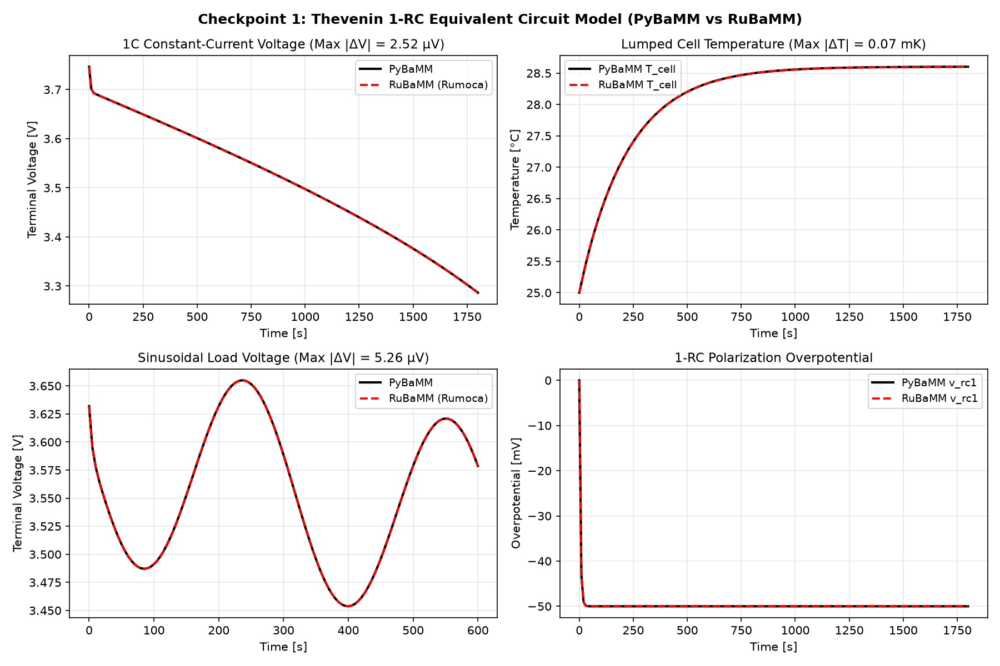
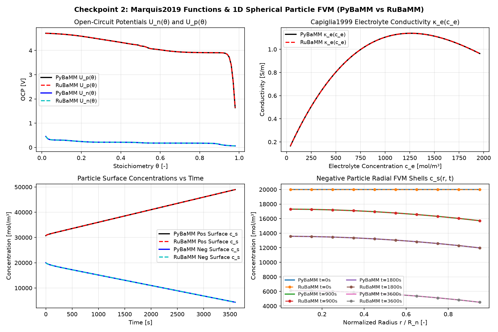
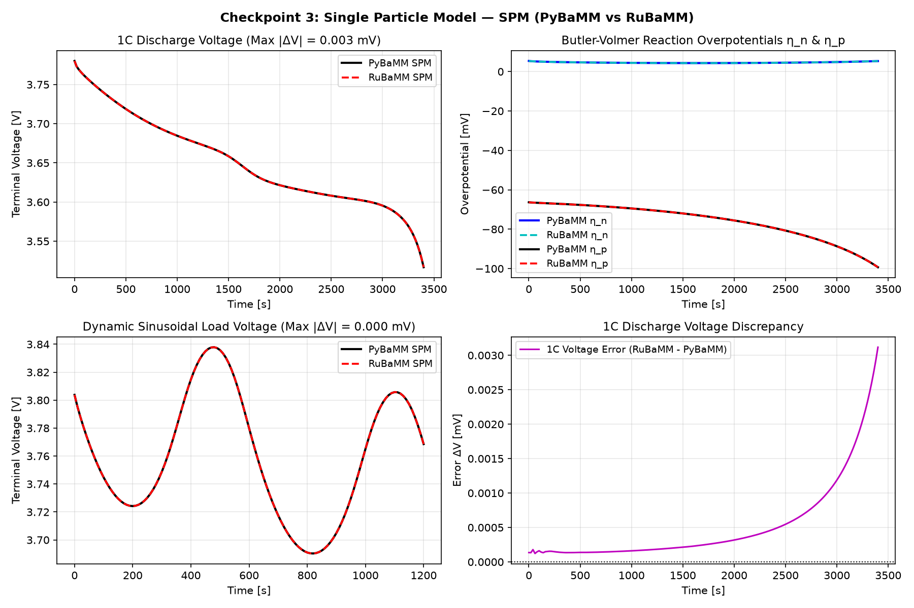
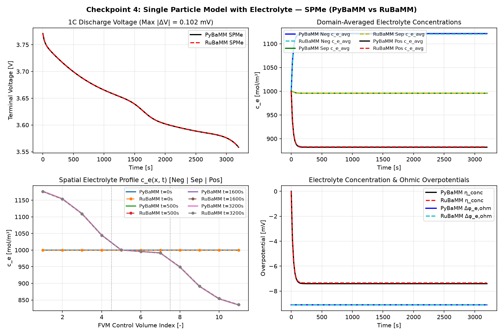
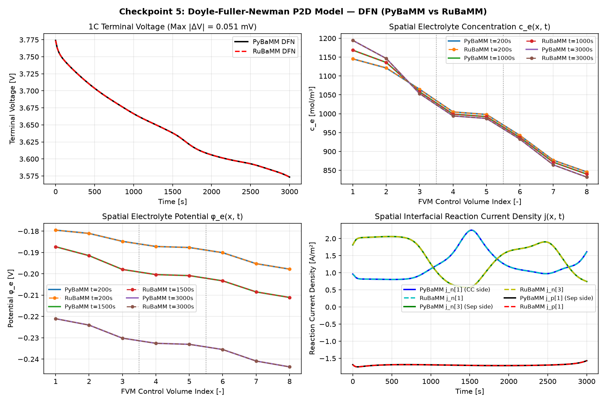
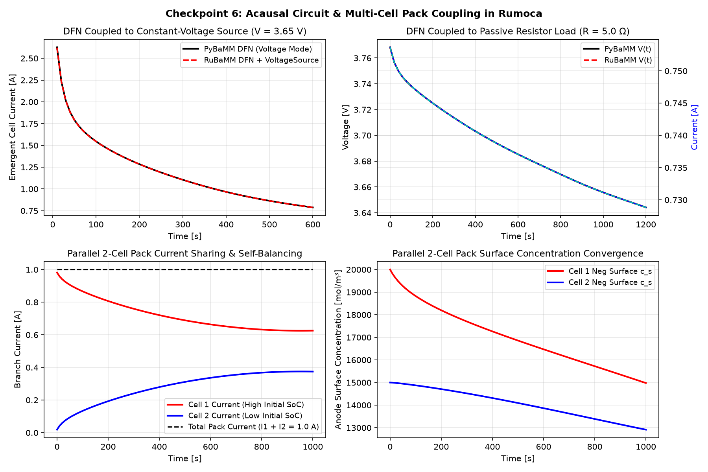
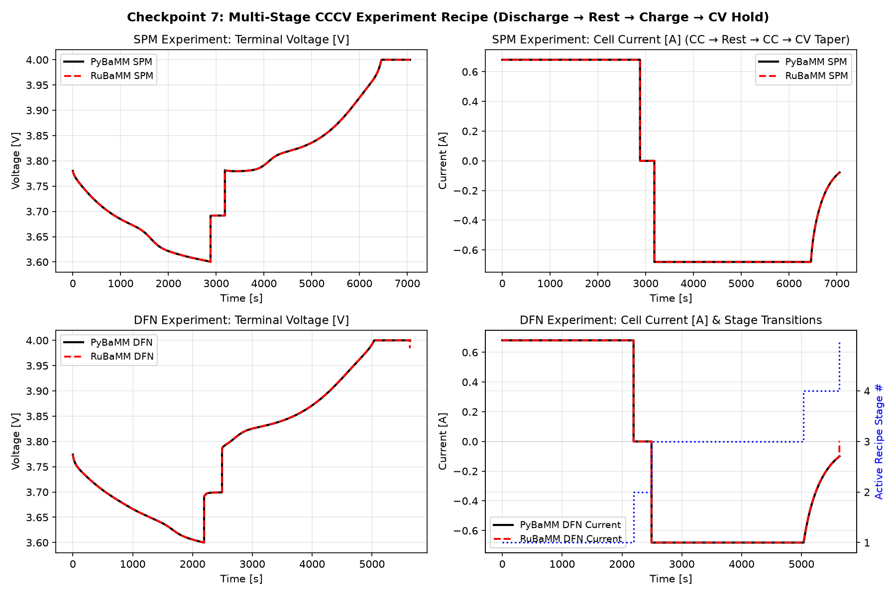

# RuBaMM

**RuBaMM** is a ground-up, native Modelica (`.mo`) implementation of [PyBaMM](https://pybamm.org/) battery models designed for compilation, symbolic manipulation, and acausal multi-subsystem simulation with [Rumoca](https://github.com/cognipilot/rumoca).

## Package Structure

* [`models/RuBaMM/package.mo`](models/RuBaMM/package.mo) — Root `RuBaMM` Modelica package.
* [`models/RuBaMM/Interfaces.mo`](models/RuBaMM/Interfaces.mo) — Acausal electrical connectors (`Pin`, `TwoPin`) and circuit components (`Ground`, `CurrentSource`, `PulseCurrentSource`, `VoltageSource`, `Resistor`, `CCCVCycler`).
* [`models/RuBaMM/EquivalentCircuit.mo`](models/RuBaMM/EquivalentCircuit.mo) — 1-RC `Thevenin` Equivalent Circuit Model with coupled lumped cell/jig thermal dynamics (`pybamm.equivalent_circuit.Thevenin`).
* [`models/RuBaMM/Parameters.mo`](models/RuBaMM/Parameters.mo) — Standard `Marquis2019` Graphite/LiCoO2 physical constants, analytical Open-Circuit Potentials (`U_n`, `U_p`), and Capiglia electrolyte diffusivity/conductivity (`D_e`, `kappa_e`).
* [`models/RuBaMM/Submodels.mo`](models/RuBaMM/Submodels.mo) — Reusable Finite Volume Method (FVM) electrochemical submodels:
  * `SphericalParticle` — 1D spherical FVM Fickian solid diffusion with linear surface extrapolation.
  * `j0_butler_volmer` & `eta_butler_volmer` — Symmetric Butler-Volmer exchange current density and overpotential functions.
  * `Electrolyte1D` — 1D planar FVM electrolyte mass conservation across Negative Electrode, Separator, and Positive Electrode with harmonic-mean interface diffusivities.
* [`models/RuBaMM/Cells.mo`](models/RuBaMM/Cells.mo) — Full acausal lithium-ion cell models extending `Interfaces.TwoPin`:
  * `SPM` — Single Particle Model (`pybamm.lithium_ion.SPM`).
  * `SPMe` — Single Particle Model with Electrolyte (`pybamm.lithium_ion.SPMe`).
  * `DFN` — Full Doyle-Fuller-Newman / P2D nonlinear DAE model (`pybamm.lithium_ion.DFN`).
* [`src/rubamm/experiment.py`](src/rubamm/experiment.py) — PyBaMM-style `Experiment` recipe parser and Modelica multi-stage cycler generator (`compile_experiment`).

---

## Running Equivalence Tests & Generating Plots

Activate the virtual environment and run the checkpoint `pytest` suite:

```powershell
.\.venv\Scripts\pytest -v
```

To regenerate all visual equivalence plots in [`docs/plots/`](docs/plots/):

```powershell
.\.venv\Scripts\python scripts/generate_comparison_plots.py
```

---

## Visual Equivalence Benchmarks (PyBaMM vs. RuBaMM)

### Checkpoint 1: Acausal Interfaces & Thevenin 1-RC Equivalent Circuit Model
Compares `RuBaMM.EquivalentCircuit.Thevenin` against `pybamm.equivalent_circuit.Thevenin()` under 1C constant-current discharge and sinusoidal dynamic current profiles (`tests/test_cp1_interfaces_ecm.py`).



### Checkpoint 2: `Marquis2019` Functions & 1D Spherical Particle FVM
Compares `RuBaMM.Parameters.Marquis2019` open-circuit potentials (`U_n`, `U_p`), Capiglia electrolyte transport (`D_e`, `kappa_e`), and `RuBaMM.Submodels.SphericalParticle` radial FVM shells against PyBaMM (`tests/test_cp2_particle_ocp.py`).



### Checkpoint 3: Single Particle Model (`SPM`)
Compares `RuBaMM.Cells.SPM` against `pybamm.lithium_ion.SPM()` across a 1C discharge and a dynamic sinusoidal load (`tests/test_cp3_spm.py`).



### Checkpoint 4: Single Particle Model with Electrolyte (`SPMe`)
Compares `RuBaMM.Cells.SPMe` and `RuBaMM.Submodels.Electrolyte1D` against `pybamm.lithium_ion.SPMe()` across terminal voltage, domain-averaged concentrations, spatial electrolyte profiles $c_e(x, t)$, and electrolyte overpotentials (`tests/test_cp4_spme.py`).



### Checkpoint 5: Full Doyle-Fuller-Newman (`DFN` / P2D) Model
Compares the coupled nonlinear DAE `RuBaMM.Cells.DFN` against `pybamm.lithium_ion.DFN()` on terminal voltage, spatial electrolyte concentrations $c_e(x, t)$, spatial potentials $\phi_e(x, t)$, and interfacial Butler-Volmer reaction current densities $j(x, t)$ (`tests/test_cp5_dfn.py`).



### Checkpoint 6: Acausal Circuit & Multi-Cell Pack Coupling
Demonstrates acausal coupling of unmodified `RuBaMM.Cells.DFN` and `RuBaMM.Cells.SPM` components to external `VoltageSource` (constant-voltage current taper), passive `Resistor` loads, and 2-cell parallel pack self-balancing (`tests/test_cp6_acausal_coupling.py`).



### Checkpoint 7: PyBaMM-Style `Experiment` Recipes (Multi-Stage CCCV Cycling)
Compares `rubamm.Experiment` / `compile_experiment` against `pybamm.Experiment` for multi-stage human-readable recipes (`["Discharge at 1C until 3.6 V", "Rest for 300 seconds", "Charge at 1C until 4.0 V", "Hold at 4.0 V for 600 seconds"]`) on both `SPM` and `DFN` (`tests/test_cp7_experiment.py`).


